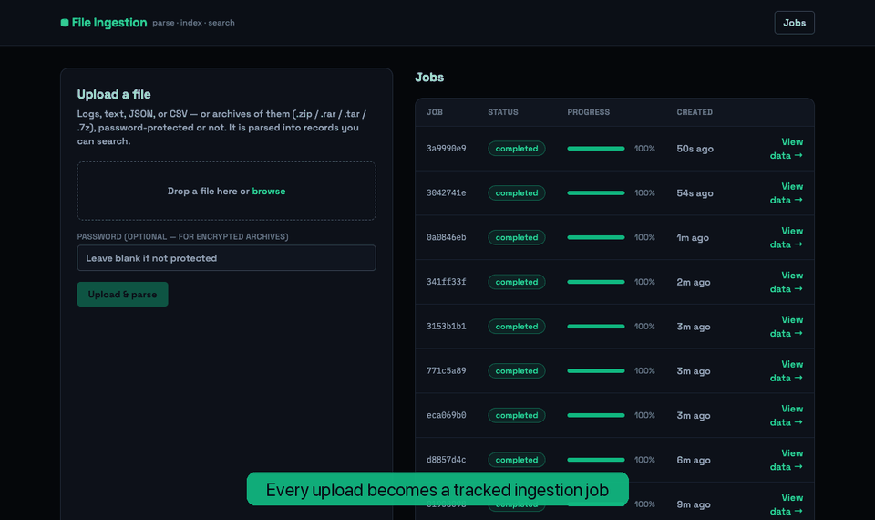
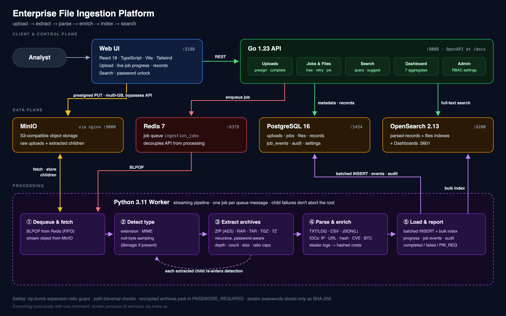
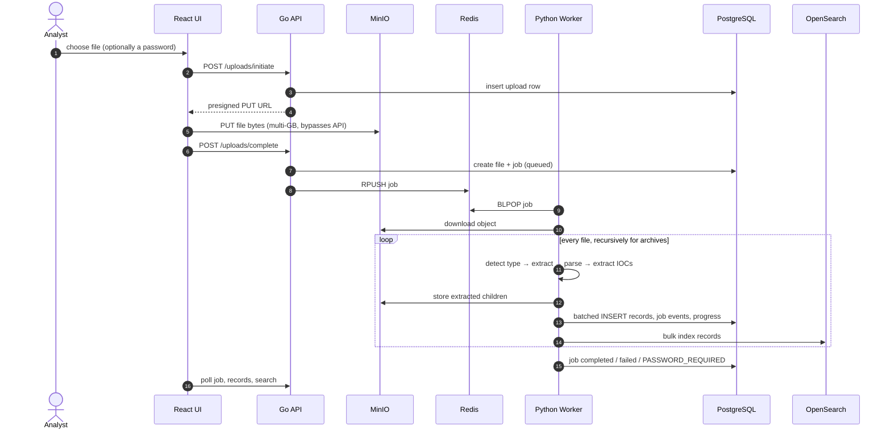

<div align="center">

# Enterprise File Ingestion Platform

**Upload a multi-GB dump of nested, password-protected archives and get back searchable,
IOC-enriched records, with an audit trail and no plaintext secrets.**

[](https://github.com/chanchalvdev/parser-app/actions/workflows/ci.yml)
[](https://github.com/chanchalvdev/parser-app/releases)
[](LICENSE)
<br/>




<sub>Real recording of the local stack: nested ZIP → live progress → search · infostealer dump → hashed credentials · AES-encrypted ZIP → password unlock</sub>

</div>

---

## Contents

- [The problem](#the-problem)
- [What it does](#what-it-does)
- [Architecture](#architecture)
- [Engineering decisions](#engineering-decisions)
- [Quick start](#quick-start)
- [Supported formats and limits](#supported-formats-and-limits)
- [API](#api)
- [Testing and CI](#testing-and-ci)
- [Project layout](#project-layout)
- [Troubleshooting](#troubleshooting)
- [Roadmap](#roadmap)

## The problem

Security, incident-response and threat-intel teams regularly receive data as **one huge,
messy file**: a 5 GB ZIP that holds RARs that hold 7Zs, some of them encrypted, full of
logs, CSV exports, JSON and infostealer credential dumps.

Triaging that by hand looks like this:

- **Slow and manual.** You unpack layer after layer, guess at encodings and `grep` through
  millions of lines with no shared index.
- **Unsafe.** A crafted archive (zip bomb, `../` path traversal) can fill the disk or write
  outside the work directory. Credential dumps end up copied around in plaintext.
- **Untraceable.** Nobody can say which file a finding came from, which nested archive
  failed, or who changed a processing limit.
- **Hard to scale.** Pushing multi-GB uploads through an application server ties up memory
  and connections.

## What it does

This platform turns that dump into a structured, searchable dataset through one upload:

| Capability | How |
|---|---|
| **Multi-GB uploads** | The browser PUTs straight to object storage with a presigned URL, so file bytes never pass through the API |
| **Recursive extraction** | ZIP (incl. AES), RAR4/5, TAR, TAR.GZ/TGZ and 7Z, nested to any configured depth; every child file is tracked in a file tree |
| **Password-protected archives** | The job pauses in `PASSWORD_REQUIRED`, the analyst unlocks it from the UI, and processing resumes; wrong attempts are recorded |
| **Parsing** | TXT/LOG, CSV (delimiter sniffing), JSON and JSONL, generic text fallback; large files stream in chunks |
| **IOC enrichment** | IPv4, emails, URLs, domains, timestamps, MD5/SHA1/SHA256, CVE IDs and Bitcoin addresses extracted from every record |
| **Infostealer awareness** | Recognises `Passwords.txt`, `Cookies/`, `Autofills/` and similar files, normalises credential blocks across stealer families, and stores passwords **only as SHA-256** (raw lines are redacted before they are persisted or indexed) |
| **Search** | Records and file metadata indexed in OpenSearch, with search and suggestions in the API and a per-job search in the UI |
| **Safety guards** | Depth, file-count, total-size and expansion-ratio limits (zip-bomb guard), path-traversal checks, binary detection |
| **Observability** | Live progress, per-stage job events, parser-error records, audit log and a 7-endpoint dashboard API |
| **Runtime config** | Limits live in a `system_settings` table, editable through an admin-only API without a redeploy |

## Architecture

<p align="center">
  
</p>

<sub>Source: [`docs/assets/architecture.svg`](docs/assets/architecture.svg)</sub>

Three tiers, each independently scalable:

1. **Control plane.** A **Go API** handles uploads, jobs, files, search, dashboard and admin
   settings. It never streams file bytes.
2. **Data plane.** **MinIO** (behind an nginx proxy tuned for large bodies) holds raw
   objects, **Redis** is the job queue, **PostgreSQL** is the source of truth, and
   **OpenSearch** is the search surface.
3. **Processing.** A **Python worker** pulls jobs from Redis and runs a streaming
   pipeline: detect → extract (recursively) → parse → enrich → batched load.

### Request lifecycle



### Job lifecycle

```text
queued ──▶ running ──▶ completed
                  ├──▶ failed               root parse/extract error (child errors are recorded, not fatal)
                  ├──▶ PASSWORD_REQUIRED    encrypted archive → POST /files/{id}/password → queued
                  └──▶ WRONG_PASSWORD       submitted password rejected, attempt recorded
```

## Engineering decisions

| Decision | Why |
|---|---|
| **Presigned direct-to-storage upload** | A 10 GB upload costs the API one small JSON request instead of 10 GB of buffered I/O. nginx in front of MinIO sets `client_max_body_size` and streaming timeouts. |
| **Queue between API and worker** | Uploads stay fast while parsing is slow. Parsing runs in its own service that scales independently of the API, and job state lives in Postgres, not in the worker. |
| **Polyglot by fit** | Go for a small, concurrent HTTP surface. Python for the parsing ecosystem (`py7zr`, `rarfile`, `pyzipper`, `ijson`, `charset-normalizer`). |
| **Streaming and batching everywhere** | Large text is chunked and JSON is parsed incrementally (`ijson`). Records are inserted and indexed in batches (`parser_batch_size`, `search_index_batch_size`). |
| **Failure isolation** | A corrupt child inside an archive becomes a `parser_errors` row. Only a root failure fails the job. |
| **Defence in depth on archives** | Every member path is normalised and rejected if absolute or traversing. Size, count, depth and expansion-ratio caps are enforced during extraction, not after. |
| **Secrets never at rest** | Stealer passwords are hashed into `secret_hash`, and the raw `PASS:` lines are rewritten to `[REDACTED sha256:<12 hex>]` before storage, so analysts can still correlate them. |
| **Postgres as the source of truth, OpenSearch as a projection** | Records are committed to Postgres first. An OpenSearch failure is recorded as an `INDEXING_FAILED` job event instead of losing data. |
| **Settings in the database** | Operators tune limits per tenant through `PUT /api/v1/admin/settings` (admin role), with no restart needed. |

## Quick start

**Prerequisites:** Docker with Compose v2 (Docker Desktop: allocate **≥ 6 GB RAM**, since OpenSearch is memory-hungry) and `make`.
Go, Python and Node are only needed to run tests outside containers.

```bash
git clone https://github.com/chanchalvdev/parser-app.git
cd parser-app
cp .env.example .env          # local-only defaults; change every secret before any shared deployment

make up                       # build + start all 9 services
make migrate                  # apply SQL migrations
make seed                     # default tenant + system_settings
make search-init              # create OpenSearch indexes
```

Then open:

| What | URL |
|---|---|
| **Web UI** | http://localhost:5188 |
| API health | http://localhost:8088/health |
| **Interactive API docs (Swagger)** | http://localhost:8088/docs |
| OpenSearch | http://localhost:9200 |
| OpenSearch Dashboards | http://localhost:5601 |
| MinIO console | http://localhost:9001 |

### Try it

```bash
# Build sample archives (ZIP, nested ZIP, TAR.GZ; plus 7Z and AES-encrypted ZIP if py7zr/pyzipper are installed)
pip install py7zr pyzipper   # optional
python3 infra/scripts/create_sample_archives.py

# Scripted end-to-end check: upload → parse → search assertions
make e2e-upload
```

In the UI, upload `tests/fixtures/sample_nested.zip` to watch recursive extraction, then
`tests/fixtures/password_sample.zip` (password `changeme`) to try the unlock flow.

<details>
<summary><b>Services and ports</b></summary>

| Service | Host port | Container port |
|---|---|---|
| `web` (React + Vite) | 5188 | 5173 |
| `api` (Go) | 8088 | 8080 |
| `worker` (Python) | none | none |
| `postgres` | 5434 | 5432 |
| `redis` | 6379 | 6379 |
| `minio-proxy` (nginx → MinIO S3 API) | 9000 | 9000 |
| `minio` console | 9001 | 9001 |
| `opensearch` | 9200 | 9200 |
| `opensearch-dashboards` | 5601 | 5601 |

The MinIO S3 API is only reachable through `minio-proxy`.
</details>

<details>
<summary><b>Make targets</b></summary>

```bash
make up / down / ps / logs / restart   # stack lifecycle
make clean                             # down -v + remove caches (destroys local data)
make migrate / seed / search-init      # database + index bootstrap
make test-api                          # go test ./...
make test-worker                       # pytest
make test-web                          # vitest
make test-all                          # all three
make e2e-upload                        # live upload → parse → search smoke test
make fmt                               # gofmt + web build
```
</details>

## Supported formats and limits

**Archives:** `.zip` (ZipCrypto and AES) · `.rar` (RAR4/RAR5) · `.tar` · `.tar.gz` / `.tgz` · `.7z`. All can be nested and password-protected.

| Parser | Handles | Status |
|---|---|---|
| `txt` | `txt`, `log`, `out`, `err`, `text/plain` + infostealer routing | ✅ implemented |
| `csv` | `csv` (delimiter sniffing, header cleaning) | ✅ implemented |
| `json` | `json`, `jsonl` (streaming) | ✅ implemented |
| `generic_text` | anything text-like | ✅ implemented |
| `xml` · `excel` · `pdf` | `xml`, `xlsx`, `pdf` | 🚧 registered scaffolds: raise `UnsupportedParserError` |

Detection uses extension, MIME and null-byte sampling (plus libmagic if installed).
Unparseable files are recorded with `NO_PARSER_FOUND` instead of failing the job.

**Runtime limits** (seeded into `system_settings`, editable via the admin API):

| Setting | Default |
|---|---|
| `max_upload_size_mb` | 10240 (10 GB) |
| `max_archive_depth` | 20 |
| `max_extracted_files` | 1,000,000 |
| `max_extracted_size_mb` | 102400 |
| `max_expansion_ratio` | 100 |
| `txt_small_file_limit_mb` | 10 (above this, text is chunked) |
| `parser_batch_size` / `search_index_batch_size` | 1000 / 1000 |

Exceeding an extraction limit fails the job with `ArchiveLimitsExceededError` at the `archive_extract` stage.

## API

Full interactive reference: **http://localhost:8088/docs** (OpenAPI JSON at `/docs/openapi.json`).

| Area | Endpoints |
|---|---|
| Health | `GET /health` · `GET /ready` · `GET /api/v1/version` |
| Uploads | `POST /api/v1/uploads/initiate` · `POST /api/v1/uploads/complete` · `GET /api/v1/uploads/{id}` |
| Files | `GET /api/v1/files` · `GET /files/{id}` · `GET /files/{id}/children` · `GET /files/{id}/tree` · `GET /files/{id}/records` · `POST /files/{id}/password` |
| Jobs | `GET /api/v1/jobs` · `GET /jobs/{id}` · `GET /jobs/{id}/events` · `GET /jobs/{id}/records` · `POST /jobs/{id}/retry` |
| Search | `GET` / `POST /api/v1/search` · `GET /api/v1/search/suggestions` |
| Dashboard | `summary` · `file-types` · `processing-status` · `upload-volume` · `error-breakdown` · `entities` · `processing-duration` |
| Admin (role `admin`) | `GET` / `PUT /api/v1/admin/settings` |

```bash
curl -s localhost:8088/api/v1/dashboard/summary | jq
# {"total_uploads":10,"total_files":29,"total_extracted_files":28,"total_parsed_records":122,"completed_jobs":9, ...}
```

## Testing and CI

| Suite | Command | Coverage |
|---|---|---|
| Go API | `make test-api` | handlers, services, repositories (19 tests) + `go vet` in CI |
| Python worker | `make test-worker` | archive safety (traversal, limits, 7z, AES zip), file detection, CSV/JSON parsers, entity extraction, infostealer grammar and redaction, FIFO queue order (37 tests) |
| Web | `make test-web` | Vitest + production build |
| End-to-end | `make e2e-upload` | live upload → worker → Postgres → OpenSearch assertions |

GitHub Actions ([`ci.yml`](.github/workflows/ci.yml)) runs the API, worker and web jobs on every push to `master`, every pull request and every version tag.

## Project layout

```text
apps/
  api/        Go HTTP API: handlers → services → repositories, OpenAPI docs
  worker/     Python worker: queue consumer, orchestrator, extractors/, parsers/, loaders
  web/        React + Vite + Tailwind dashboard
infra/
  migrations/ SQL schema + seed
  opensearch/ index mappings bootstrap
  docker/     nginx config for the MinIO proxy
  scripts/    migrate / seed / sample-archive helpers
scripts/      e2e-upload.sh
tests/        fixtures (sample logs, CSV, JSON, synthetic stealer dump, nested archive source)
docs/         architecture diagram, demo, design notes (docs/plans/)
```

Design notes: [system usage guide](docs/plans/system-usage-guide.md) ·
[5 GB upload plan](docs/plans/plan-5gb-uploads.md) ·
[live status plan](docs/plans/plan-live-status-and-eye-icon.md) ·
[UX redesign spec](docs/plans/ux-redesign-spec.md)

## Troubleshooting

<details>
<summary>Expand</summary>

- **API not ready:** `docker compose logs api postgres`; check `DATABASE_URL` in `.env`.
- **Jobs stuck in `queued`:** `docker compose logs worker`; check the queue with
  `docker exec file-platform-redis redis-cli LLEN ingestion_jobs`.
- **Upload fails in the browser:** `MINIO_PRESIGN_ENDPOINT` must be reachable from the browser
  (default `http://localhost:9000`), and `minio-proxy` must be healthy.
- **"File too large":** `max_upload_size_mb` in `system_settings` is the effective limit;
  check `GET /api/v1/admin/settings`.
- **Search returns nothing:** `curl localhost:9200/_cat/indices?v`. Re-run `make search-init`
  after wiping OpenSearch data.
- **CORS errors:** `ALLOWED_ORIGINS` (API) must include `http://localhost:5188`, and
  `VITE_API_BASE_URL` (web) must be `http://localhost:8088/api/v1`. Both are set in `.env.example`.
- **`make migrate` says "relation already exists":** the named volumes already hold a migrated
  database. Skip it, or `make clean` to start from scratch.
- **Containers OOM / OpenSearch exits:** give Docker more memory (≥ 6 GB).
</details>

## Roadmap

- [ ] Implement the XML, XLSX and PDF parsers (scaffolds are already registered)
- [ ] Prometheus metrics for API and worker (queue depth, stage latency, records/sec)
- [ ] Export endpoints (CSV/JSON) for search results and credential sets
- [ ] Multi-tenant auth end to end (tenant scoping exists in schema and settings)
- [ ] Linting gates (golangci-lint, ruff, eslint) in CI

## Author

Built by **Chanchal** ([@chanchalvdev](https://github.com/chanchalvdev)). Issues and PRs are welcome.

## License

[MIT](LICENSE)
